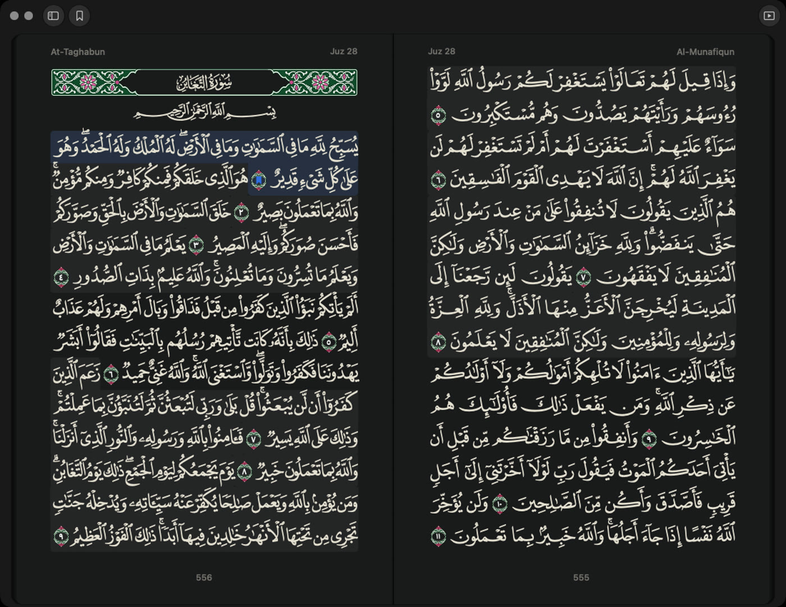
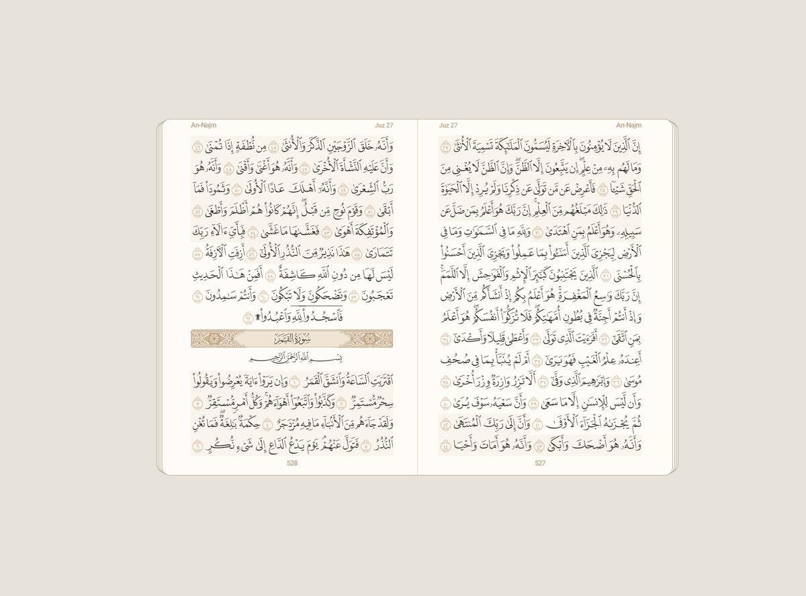

  

<h1 align="center">Istimaa</h1>

  <em>istimāʿ (استماع) — listening</em> 
  Listen to the Quran and read along in the Madinah mushaf. 
  <a href="https://istimaa.vercel.app">Website</a> ·
  <a href="https://istimaa.fider.io/">Feature requests</a>

This repository hosts the downloadable builds of Istimaa for macOS and Android. The source code is private; only release files live here.

## Download

| Platform | Version | File | Requirements |
|---|---|---|---|
| macOS | 1.2.14 | [Istimaa-1.2.14.dmg](https://github.com/daimagine/istimaa-releases/releases/download/mac-v1.2.14/Istimaa-1.2.14.dmg) | macOS 13 or later |
| Android | 0.2.15 | [Istimaa-0.2.15.apk](https://github.com/daimagine/istimaa-releases/releases/download/android-v0.2.15/Istimaa-0.2.15.apk) | Android tablets, e-ink readers and phones |

All versions and their notes are on the [Releases](https://github.com/daimagine/istimaa-releases/releases) page.

  
  

## What it does

- **Recitation** from many reciters, with repeat modes (ayah, surah, juz, custom ranges) and offline downloads.
- **Madinah 1441H mushaf**, one or two pages, that follows the ayah you hear.
- **Translation and tafsir** in the Library, following along with playback.
- **Hifz mode**: hide the text and reveal it word by word as the reciter reads.
- **Bookmark collections**: sort bookmarks into named, coloured collections (Hifz, Murajaah, Tafsir, Du'a, or your own).
- **Android**: the same mushaf on tablets, e-ink readers and phones, with a swipe or page-fold turn.

## Install

### macOS

1. Download the `.dmg` and open it.
2. Drag **Istimaa** into **Applications**.
3. Open Istimaa from Applications. If macOS warns that it can't check the app, right-click the app, choose **Open**, then **Open** again. This is only needed the first time.

### Android

1. Download the `.apk` on your device.
2. Open it. If asked, allow your browser or file manager to install unknown apps.
3. Tap **Install**.

New versions install over the old one and keep your bookmarks, settings and downloads. You don't need to uninstall first.

## Feedback

Ideas and bug reports are welcome on the [feature request board](https://istimaa.fider.io/).

---

<strong>Bahasa Indonesia</strong>

Istimaa: dengarkan Al-Qur'an dan ikuti bacaannya di mushaf Madinah. Repositori ini hanya berisi file unduhan untuk macOS dan Android; kode sumbernya privat.

- **macOS:** unduh `.dmg`, buka, lalu seret **Istimaa** ke **Applications**. Saat pertama kali dibuka, jika macOS memberi peringatan, klik kanan aplikasinya, pilih **Open**, lalu **Open** lagi.
- **Android:** unduh `.apk` di perangkat, buka, izinkan instalasi aplikasi dari sumber tidak dikenal jika diminta, lalu ketuk **Install**. Versi baru terpasang di atas versi lama tanpa menghapus penanda, pengaturan, dan unduhan.

Semua versi ada di halaman [Releases](https://github.com/daimagine/istimaa-releases/releases). Situs: [istimaa.vercel.app](https://istimaa.vercel.app)

